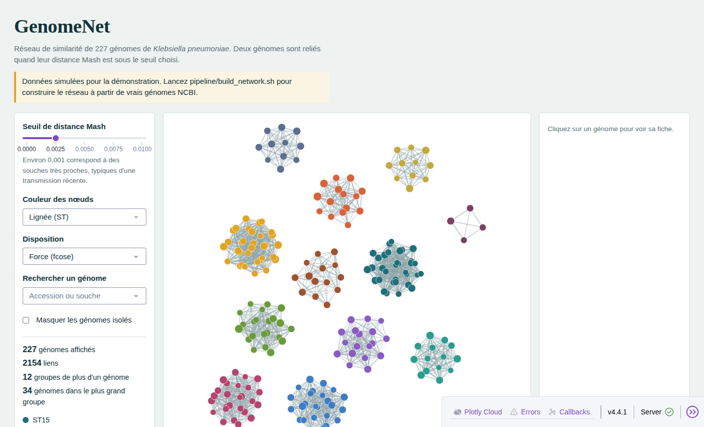

# GenomeNet

**Démo en ligne : https://mamoudou-cheikh-kane.github.io/genomenet/**

Réseau interactif de similarité de génomes de *Klebsiella pneumoniae*, construit à partir des assemblages complets de NCBI RefSeq et exploré avec Dash et Cytoscape.



## La question

*K. pneumoniae* est un pathogène hospitalier majeur, classé prioritaire par l'OMS en raison de ses souches résistantes aux carbapénèmes. Sa population est structurée en lignées clonales (ST258, ST11, ST147, ST307...) dont certaines concentrent la résistance et se diffusent à l'échelle mondiale. Ce projet permet de voir cette structure : en faisant varier le seuil de distance génomique, on observe les génomes se regrouper en lignées, puis en grappes de souches quasi identiques qui évoquent une transmission récente.

## Ce que l'on peut faire dans l'application

- Faire varier le seuil de distance Mash et voir les groupes se former ou se séparer en direct.
- Colorer les génomes par lignée (ST), pays, année de prélèvement, présence d'une carbapénémase ou groupe au seuil choisi.
- Rechercher une souche et mettre en évidence ses voisins directs.
- Cliquer sur un génome pour afficher sa fiche : métadonnées, gènes de résistance, lien vers NCBI.
- La taille des nœuds est proportionnelle au nombre de gènes de résistance détectés.

## Méthode

1. **Sélection** : liste des assemblages complets RefSeq via `ncbi-datasets`, puis tirage de 250 génomes (graine fixe), en privilégiant ceux dont le pays d'origine est renseigné. NCBI ajoutant des génomes en permanence, la liste tirée est figée dans `data/accessions.txt` : relancer le pipeline réanalyse exactement les mêmes génomes.
2. **Distances** : esquisses Mash (k = 21, 10 000 hashes) et distances toutes contre toutes. La distance Mash approxime 1 moins l'identité nucléotidique moyenne (ANI).
3. **Typage** : MLST avec `mlst`, en imposant le schéma *Klebsiella* (le choix automatique du schéma s'est révélé peu fiable, voir les observations), et gènes de résistance avec AMRFinderPlus.
4. **Réseau** : une arête relie deux génomes dont la distance est inférieure au seuil. Les groupes sont les composantes connexes du graphe.

Limites assumées : un réseau à seuil n'est pas une phylogénie, et l'échantillon RefSeq reflète les biais de séquençage (surreprésentation de certains pays et des souches multirésistantes).

## Observations

**1. Le choix automatique du schéma MLST n'est pas fiable ici.** Pour 66 génomes sur 250, mlst obtient un score parfait à la fois dans le schéma *Klebsiella* et dans le schéma *E. coli* d'Achtman, et choisit alors arbitrairement : 36 génomes (14 %) ont ainsi été typés comme *E. coli* (ST14464, ST11307, ST7362). Les distances Mash les plaçaient pourtant au cœur des lignées de *K. pneumoniae*, et le typage avec le schéma *Klebsiella* imposé les attribue à ST11 (20), ST307 (6), ST258 (4), ST512 (2), ST437 (2), ST35 (1) et ST340 (1). Chaque profil *E. coli* correspond toujours à la même lignée de *Klebsiella* (ST14464 au complexe clonal CG258, ST11307 à ST307, ST7362 à ST35), ce qui suggère que la base *E. coli* contient des profils issus de souches de *Klebsiella*, plutôt qu'une contamination des génomes. Conséquence pratique : imposer le schéma quand l'espèce est connue, et croiser deux méthodes indépendantes.

**2. La résistance aux carbapénèmes se concentre dans quelques clones à haut risque.** Elle touche ST11 (37 génomes sur 39), ST258 (11 sur 11), ST147 (10 sur 10), ST231 (8 sur 8) et ST307 (10 sur 11). À l'inverse, ST23, lignée décrite comme hypervirulente, n'en porte que dans 3 cas sur 11. Ces trois cas méritent attention, car la convergence entre virulence et résistance est une préoccupation majeure ; la confirmer demanderait de rechercher les gènes de virulence, par exemple avec Kleborate.

**3. L'échantillon public reflète l'effort de séquençage plus que l'épidémiologie.** La Chine et Taïwan fournissent 115 génomes sur 250 (46 %), et 169 génomes (68 %) portent une carbapénémase, car les souches multirésistantes sont séquencées en priorité. L'Afrique ne compte que 4 génomes sur 250 (1,6 % : Malawi, Égypte, Ghana), et aucun d'Afrique de l'Ouest.

## Lancer l'application en local

```bash
pip install -r requirements.txt
python app.py
# puis ouvrir http://127.0.0.1:8050
```

Sans données réelles dans `data/`, l'application utilise un jeu **simulé** (`data/demo/`, régénérable avec `python pipeline/make_demo_data.py`) et l'indique par un bandeau.

## Reconstruire le réseau à partir de vrais génomes

```bash
conda env create -f environment.yml
conda env create -f environment-mlst.yml   # mlst dans un environnement séparé
conda activate genomenet-pipeline
amrfinder -u                               # télécharge la base AMRFinderPlus
bash pipeline/build_network.sh             # produit data/nodes.csv et data/edges.csv
```

Paramètres modifiables par variables d'environnement : `N` (nombre de génomes, 250 par défaut), `THREADS`, `MAX_DIST` (0.01), `SEED` (42), `SPECIES` et `AMR_ORGANISM` pour changer d'espèce. Compter environ 1 Go de téléchargement et de quelques dizaines de minutes à une heure selon la machine, AMRFinderPlus étant l'étape la plus longue. Si la connexion coupe, relancez simplement le script : le téléchargement reprend là où il s'était arrêté.

## Structure

```
app.py                      application Dash + Cytoscape
assets/style.css            mise en forme
data/                       nodes.csv et edges.csv produits par le pipeline
data/demo/                  données simulées de secours
pipeline/build_network.sh   pipeline complet
pipeline/select_genomes.py  tirage des génomes
pipeline/to_csv.py          fusion Mash, MLST, AMR et métadonnées
pipeline/ncbi_meta.py       lecture des rapports NCBI
pipeline/build_static.py    génération de la démo statique (docs/index.html)
Dockerfile                  déploiement de l'application Dash en conteneur
```

## Démo en ligne

La démo publique est une version statique de l'application : une seule page HTML (`docs/index.html`) qui embarque les données et affiche le réseau avec Cytoscape.js, la bibliothèque sur laquelle repose Dash Cytoscape. Elle est servie gratuitement par GitHub Pages, sans serveur ni mise en veille. Pour la régénérer après une mise à jour des données :

```bash
python pipeline/build_static.py
```

L'application Dash (`app.py`) reste la version de référence pour un usage local. Le `Dockerfile` permet aussi de la déployer sur un hébergeur qui exécute des conteneurs.

## Outils

Python, Dash, Dash Cytoscape, Cytoscape.js, pandas, NCBI Datasets, Mash, mlst, AMRFinderPlus, Docker.

## Licence

MIT
